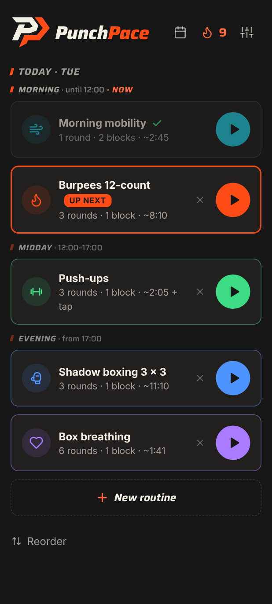
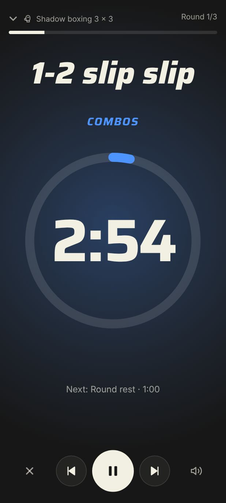
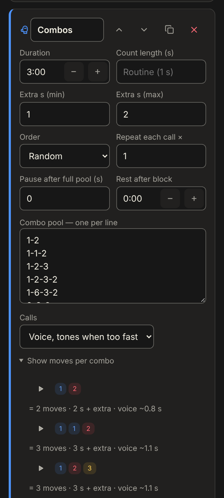
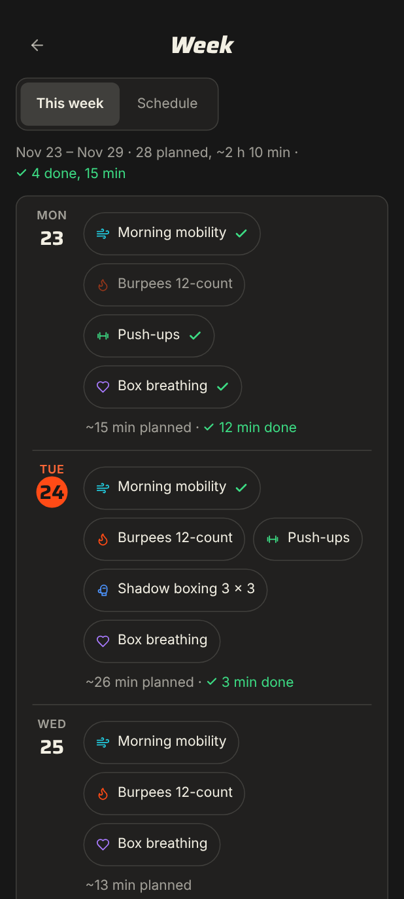

# PunchPace

_Think once. Move without thinking._

PunchPace talks you through the routines you repeat every day or week, from a morning stretch to a boxing session, so you can keep your eyes off the screen and just move.

<p>
  
  
  
  
</p>

## Try it

Open **https://punchpace.app**. On Android, open it in Chrome and choose ⋮ → _Install app_ to get it on your home screen; it works offline from then on.

You don't need an account. Without one, everything stays on your device. Sign in with Google or GitHub only if you want your routines and workouts on more than one device.

Used the app at its old address (agepoor.github.io/repflow or workout-pacer.web.app)? Opening it there brings your routines over to punchpace.app.

## What it does

- **Guides you by voice:** it counts, times and calls out each step, so you never have to look.
- **Fits any routine:** reps, timed work, step-by-step sequences, boxing combos and rest, in as many rounds as you like.
- **Plans your day:** routines show up on the days and times of day you choose, with a gentle hint about what's next.
- **Keeps track:** workouts are logged, with streaks and a week overview.
- **Works anywhere:** installable, works offline, and syncs across devices if you sign in.

## Run it locally

You need git, bash and Python 3. There's no install step and no bundler: the app is plain JavaScript modules served as static files.

```bash
git clone https://github.com/agepoor/repflow.git
```

```bash
cd repflow
```

```bash
bash build.sh _site
```

```bash
python3 -m http.server 8000 -d _site
```

Open http://localhost:8000. Run `bash build.sh _site` again after every change; `_site` is build output, so don't commit it. Opening `index.html` straight from disk doesn't work, because browsers don't load JavaScript modules over `file://`.

Everything works locally except signing in, which only works on the app's own addresses. To work on sign-in and sync, see [Your own Firebase](#your-own-firebase).

## Develop

The checks need Node 22.12 or newer.

```bash
npm ci
```

```bash
npm run check
```

`npm run check` runs ESLint, Prettier and the tests; run it before every commit. While working, `npm run test:watch` reruns the tests on every save and `npm run format` fixes formatting. `npm run test:rules` tests the database security rules in the Firebase emulator (needs Java 11 or newer). After changing the design tokens in `design/tokens.json`, `npm run tokens` writes `tokens.css`.

Where things are:

- `index.html`, `styles.css`: the page and all its styles. Colours, spacing and type come from the design tokens; the rules for them are in [`design/README.md`](design/README.md).
- `core/`: the app's logic (routines, schedule, timer, voice timing, sync merging), with no DOM, so it runs and is tested in Node.
- `ui/`: everything on screen and on the device. It calls into `core/`, never the other way round.
- `cloud.js`: sign-in and sync (Firebase), loaded only when needed.
- `schema/routine.schema.json`: the routine format.
- `test/`: one test file per `core/` module, and `test/rules/` for the database rules.
- `sw.js`: the offline cache. `build.sh`: builds the site.

[`CLAUDE.md`](CLAUDE.md) has the full list of rules: the security policy (no inline scripts or handlers), storage keys that must never be renamed, how routine format changes are migrated, and more.

Every push to `main` deploys to the live app, so all changes go through a pull request. CI runs the same checks on every pull request and posts a preview link.

## Your own Firebase

Sign-in and sync use Firebase. The config in `cloud.js` is public; access is limited by `database.rules.json`, and the project only accepts requests from the app's own addresses. To run sign-in and sync yourself, use your own Firebase project:

1. Create a project with a Realtime Database (locked mode) and paste `database.rules.json` into its Rules.
2. Authentication: turn on Google, and GitHub with a GitHub OAuth app whose callback is `https://<authDomain>/__/auth/handler`. Add `localhost` and your own domain under Settings → Authorized domains.
3. Project settings → add a Web app and paste its config into `FIREBASE_CONFIG` in `cloud.js` (it must include `databaseURL`). Set `authDomain` to `<project-id>.firebaseapp.com`, or to your own domain if you host the app on Firebase Hosting.
4. Set up App Check with reCAPTCHA Enterprise and put its site key in `APP_CHECK`. When testing locally, set `APP_CHECK_DEBUG` to `true` and add the token it prints under App Check → Manage debug tokens.

To test without a Firebase project, `EMULATOR` in `cloud.js` points sign-in and the database at the Firebase Emulator Suite.

## Security

Found a security problem? Please report it privately, not in a public issue: see [SECURITY.md](SECURITY.md).

## Privacy

Without an account, nothing leaves your device. With one, routines and workouts sync through Firebase (database in Belgium). There are no ads, analytics or tracking. [privacy.html](privacy.html), also linked in the app's Settings, says what's stored, where, and how to delete it.

## Licence

The code is licensed under the [Apache License 2.0](LICENSE): use, change and share it, also in closed or commercial apps, as long as you keep the licence and copyright notices and mark the files you changed. Contributions are accepted under the same licence. The licence gives no right to use the PunchPace name or logo as your own (section 6).

The display type is [Saira](https://github.com/Omnibus-Type/Saira), under the SIL Open Font License 1.1 (`fonts/OFL.txt`).
